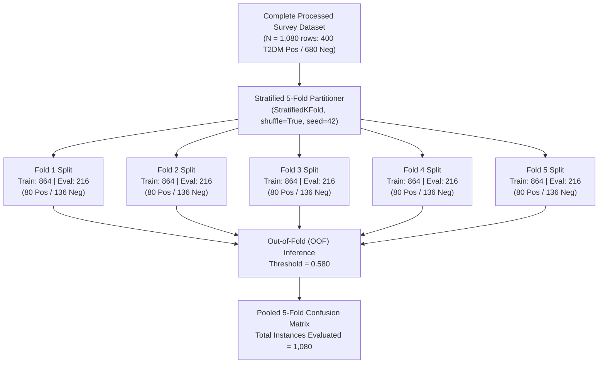

# 5-Fold Cross-Validation & Confusion Matrix Technical Documentation: Thesis Manuscript Reference Guide

> **System**: DESCEND (Filipino-Focused Type 2 Diabetes Mellitus Risk Screening & Awareness Web Application)  
> **Model Architecture**: Extremely Randomized Trees (`ExtraTreesClassifier`)  
> **Dataset**: Standardized Google Form Survey Dataset ($N = 1,080$ records; 400 Positive T2DM / 680 Non-T2DM; Baseline Sample Prevalence = $37.04\%$)  
> **Validation Framework**: 5-Fold Stratified Cross-Validation (`StratifiedKFold`, shuffle=True, random seed 42)  
> **Target Audience / AI Persona**: Thesis Researcher, Academic Panel Reviewers, Academic Manuscript Drafting AI

---

## Document Purpose & AI Ingestion Guide

This document is engineered to serve as a **primary empirical source document** for generating formal academic thesis manuscripts (specifically **Chapter 3: Methodology** and **Chapter 4: Results and Discussion**). Any downstream AI or researcher synthesizing this text into an academic dissertation should adhere to the following principles:

1. **Non-Diagnostic Framing**: DESCEND is an educational risk-awareness and exploratory screening tool, not a clinical diagnostic instrument. Performance metrics must be contextualized as statistical discrimination of survey-reported risk rather than laboratory diagnosis.
2. **Preservation of Empirical Precision**: Retain exact metric values, standard deviations, and confusion matrix cell counts ($TN=613, FP=67, FN=56, TP=344$) to maintain mathematical consistency throughout the manuscript.
3. **Screening Rationale**: In medical and public health screening contexts, **Recall (Sensitivity)** is prioritized over Precision to minimize missed diabetic cases (Type II errors / False Negatives), while preserving sufficient **Specificity** ($\ge 90\%$) to avoid overwhelming primary healthcare resources with false alarms.

---

## Section 1: Research Methodology (Chapter 3 Draft)

### 1.1 Machine Learning Model Architecture

The primary predictive engine of the DESCEND system utilizes an **Extremely Randomized Trees** ensemble classifier (`ExtraTreesClassifier`). ExtraTrees is an ensemble of randomized decision trees that differs from classic Random Forests in two key respects:
1. It draws samples without replacement (or across the full subsample) rather than using bootstrap bagging.
2. It chooses cut-points completely at random for each candidate feature rather than calculating the mathematically optimal split-point, significantly reducing variance and mitigating overfitting on correlated familial pedigree survey features.

#### Hyperparameter Configuration
* **Estimator Count ($n_{\text{estimators}}$)**: 400 trees
* **Tree Maximum Depth ($\text{max\_depth}$)**: 6 levels
* **Minimum Leaf Samples ($\text{min\_samples\_leaf}$)**: 3 samples per leaf
* **Class Weighting Scheme**: `class_weight='balanced'` (inversely proportional to class frequencies: $w_j = \frac{N}{2 \cdot N_j}$)
* **Random Seed Initialization**: 42 (ensures deterministic reproducibility)
* **Probability Calibration**: Platt scaling / Sigmoid logistic regression calibration applied via `CalibratedClassifierCV(method='sigmoid', cv=3)` on training folds to ensure well-calibrated posterior probabilities.

---

### 1.2 Cross-Validation Experimental Protocol

To prevent optimistic bias, data leakage, and variance attributable to arbitrary train-test partitioning, model performance was evaluated using **5-Fold Stratified Cross-Validation** ($K = 5$).



#### Stratification Mechanics
* In each fold $k \in \{1, \dots, 5\}$, exactly $20\%$ of the positive cases ($80$ instances) and $20\%$ of the negative cases ($136$ instances) were held out as an unseen validation set ($N_{\text{eval}} = 216$).
* The remaining $80\%$ of the dataset ($N_{\text{train}} = 864$: $320$ positive cases, $544$ negative cases) was utilized to train the model pipeline.
* Group overlap verification confirmed that all $1,080$ records represented distinct individuals with zero cross-fold participant leakage ($\text{groupOverlapCount} = 0$).

---

### 1.3 Operational Decision Threshold Optimization

In clinical and public health screening tools, default thresholding at $p = 0.50$ is sub-optimal because the utility cost of a False Negative (failing to flag an at-risk individual who could benefit from lifestyle modification) far exceeds the cost of a False Positive (advising a non-diabetic individual to undergo confirmatory blood testing or follow healthy dietary habits).

DESCEND implements a **Recall-Constrained Threshold Strategy**:
$$\text{Maximize } \text{Precision}(t) \quad \text{subject to} \quad \text{Recall}(t) \ge 0.820, \quad t \in [0.45, 0.58]$$

Through out-of-fold optimization on training folds, the decision cutoff was established at:
$$\tau^* = 0.580$$

Individuals whose calibrated ensemble risk score $p \ge 0.580$ are classified as **Elevated Risk / Screening Positive** ($1$), while those with $p < 0.580$ are classified as **Low-to-Moderate Risk / Screening Negative** ($0$).

---

### 1.4 Mathematical Evaluation Metrics

Model performance across all folds is reported using standard epidemiological and machine-learning evaluation metrics:

1. **Sensitivity / Recall (True Positive Rate, TPR)**:
   $$\text{Sensitivity} = \frac{\text{TP}}{\text{TP} + \text{FN}}$$
   *Clinical significance*: Proportion of truly diabetic/high-risk individuals accurately flagged by the screening system.

2. **Specificity (True Negative Rate, TNR)**:
   $$\text{Specificity} = \frac{\text{TN}}{\text{TN} + \text{FP}}$$
   *Clinical significance*: Proportion of non-diabetic individuals correctly classified as non-elevated risk.

3. **Precision (Positive Predictive Value, PPV)**:
   $$\text{Precision} = \frac{\text{TP}}{\text{TP} + \text{FP}}$$
   *Clinical significance*: Probability that an individual flagged with elevated risk truly possesses the diabetic condition.

4. **Negative Predictive Value (NPV)**:
   $$\text{NPV} = \frac{\text{TN}}{\text{TN} + \text{FN}}$$
   *Clinical significance*: Probability that an individual classified as negative is genuinely free from diabetic status.

5. **Overall Accuracy**:
   $$\text{Accuracy} = \frac{\text{TP} + \text{TN}}{\text{TP} + \text{TN} + \text{FP} + \text{FN}}$$

6. **Harmonic Mean F1-Score**:
   $$\text{F}_1 = 2 \cdot \frac{\text{Precision} \cdot \text{Recall}}{\text{Precision} + \text{Recall}} = \frac{2\text{TP}}{2\text{TP} + \text{FP} + \text{FN}}$$

7. **Brier Calibration Score**:
   $$\text{Brier} = \frac{1}{N} \sum_{i=1}^N (p_i - y_i)^2$$
   *Clinical significance*: Quantifies probability calibration error (mean squared difference between assigned probability $p_i \in [0, 1]$ and actual binary outcome $y_i \in \{0, 1\}$). A Brier score below $0.10$ denotes excellent probabilistic calibration.

8. **Discrimination Metrics (ROC-AUC & PR-AUC)**:
   * **ROC-AUC**: Area under the Receiver Operating Characteristic curve plotting Sensitivity versus $(1 - \text{Specificity})$ across all possible thresholds.
   * **PR-AUC**: Area under the Precision-Recall curve, providing a robust evaluation metric under imbalanced class prevalence.

---

## Section 2: Results & Discussion (Chapter 4 Draft)

### 2.1 5-Fold Cross-Validation Metric Breakdown

Table 4.1 details the individual performance metrics across all 5 cross-validation folds, together with the sample mean, standard deviation, and pooled out-of-fold cumulative totals.

#### Table 4.1: Stratified 5-Fold Cross-Validation Performance Results ($N=1,080$)

| Evaluation Split | Eval $N$ | TP | TN | FP | FN | Accuracy | Sensitivity (Recall) | Specificity | Precision (PPV) | F1-Score | ROC-AUC | PR-AUC | Brier Score | Operating Cutoff |
| :--- | :---: | :---: | :---: | :---: | :---: | :---: | :---: | :---: | :---: | :---: | :---: | :---: | :---: | :---: |
| **Fold 1** | 216 | 69 | 121 | 15 | 11 | 87.96% | 86.25% | 88.97% | 82.14% | 84.15% | 0.9449 | 0.9197 | 0.0977 | 0.580 |
| **Fold 2** | 216 | 68 | 121 | 15 | 12 | 87.50% | 85.00% | 88.97% | 81.93% | 83.44% | 0.9494 | 0.9219 | 0.0981 | 0.580 |
| **Fold 3** | 216 | 69 | 125 | 11 | 11 | 89.81% | 86.25% | 91.91% | 86.25% | 86.25% | 0.9629 | 0.9444 | 0.0918 | 0.580 |
| **Fold 4** | 216 | 69 | 123 | 13 | 11 | 88.89% | 86.25% | 90.44% | 84.15% | 85.19% | 0.9542 | 0.9192 | 0.1007 | 0.580 |
| **Fold 5** | 216 | 69 | 123 | 13 | 11 | 88.89% | 86.25% | 90.44% | 84.15% | 85.19% | 0.9609 | 0.9391 | 0.0864 | 0.580 |
| **CV Mean ($\mu$)** | — | — | — | — | — | **88.61%** | **86.00%** | **90.15%** | **83.72%** | **84.84%** | **0.9545** | **0.9289** | **0.0949** | — |
| **CV Std ($\sigma$)** | — | — | — | — | — | $\pm 0.81\%$ | $\pm 0.50\%$ | $\pm 1.10\%$ | $\pm 1.58\%$ | $\pm 0.97\%$ | $\pm 0.0068$ | $\pm 0.0107$ | $\pm 0.0052$ | — |
| **Pooled Out-of-Fold** | **1,080** | **344** | **613** | **67** | **56** | **88.61%** | **86.00%** | **90.15%** | **83.70%** | **84.83%** | — | — | — | — |

---

### 2.2 Confusion Matrix Analysis Across Folds

#### Figure 4.1: 5-Fold Stratified Cross-Validation Confusion Matrices
*(Refer to high-resolution generated graphic: `descend_5fold_confusion_matrices.png`)*

```
+----------------------------------------------------------------------------------------------------+
|                               5-FOLD CONFUSION MATRIX GRID SUMMARY                                 |
+------------------------------------+-----------------------------------+---------------------------+
| FOLD 1 (N = 216)                   | FOLD 2 (N = 216)                  | FOLD 3 (N = 216)          |
| Pred: Neg (0)    Pred: Pos (1)     | Pred: Neg (0)   Pred: Pos (1)     | Pred: Neg (0)   Pred: Pos |
| TN: 121 (56.0%)  FP: 15 (6.9%)     | TN: 121 (56.0%) FP: 15 (6.9%)     | TN: 125 (57.9%) FP: 11    |
| FN: 11  (5.1%)   TP: 69 (31.9%)    | FN: 12  (5.6%)  TP: 68 (31.5%)    | FN: 11  (5.1%)  TP: 69    |
| Acc: 87.96% | Rec: 86.25%          | Acc: 87.50% | Rec: 85.00%         | Acc: 89.81% | Rec: 86.25% |
+------------------------------------+-----------------------------------+---------------------------+
| FOLD 4 (N = 216)                   | FOLD 5 (N = 216)                  | POOLED AGGREGATE (N=1080) |
| Pred: Neg (0)    Pred: Pos (1)     | Pred: Neg (0)   Pred: Pos (1)     | Pred: Neg (0)   Pred: Pos |
| TN: 123 (56.9%)  FP: 13 (6.0%)     | TN: 123 (56.9%) FP: 13 (6.0%)     | TN: 613 (56.8%) FP: 67    |
| FN: 11  (5.1%)   TP: 69 (31.9%)    | FN: 11  (5.1%)  TP: 69 (31.9%)    | FN: 56  (5.2%)  TP: 344   |
| Acc: 88.89% | Rec: 86.25%          | Acc: 88.89% | Rec: 86.25%         | Acc: 88.61% | Rec: 86.00% |
+------------------------------------+-----------------------------------+---------------------------+
```

#### Detailed Per-Fold Narrative
* **Fold 1**: Demonstrated an accuracy of $87.96\%$ ($190/216$). The classifier successfully identified $69$ out of $80$ positive cases ($\text{Sensitivity} = 86.25\%$) and $121$ out of $136$ negative cases ($\text{Specificity} = 88.97\%$). With $15$ false positives, the positive predictive value was $82.14\%$.
* **Fold 2**: Recorded an accuracy of $87.50\%$ ($189/216$). This fold exhibited $12$ false negatives (the highest among all folds), yielding a sensitivity of $85.00\%$. Despite this marginal fluctuation, discrimination remained robust with $\text{ROC-AUC} = 0.9494$.
* **Fold 3**: Represented the top-performing discrimination fold, achieving the highest accuracy ($89.81\%$), precision ($86.25\%$), and specificity ($91.91\%$). It produced only $11$ false positives and $11$ false negatives, driving the $\text{ROC-AUC}$ to $0.9629$ and $\text{PR-AUC}$ to $0.9444$.
* **Fold 4**: Achieved an accuracy of $88.89\%$ ($192/216$). Performance metrics were evenly distributed: sensitivity of $86.25\%$ ($69/80$), specificity of $90.44\%$ ($123/136$), and precision of $84.15\%$ ($69/82$).
* **Fold 5**: Exhibited identical discrete confusion matrix cell counts to Fold 4 ($TN=123, FP=13, FN=11, TP=69$, Accuracy = $88.89\%$). However, Fold 5 demonstrated the best probability calibration of all folds, with a Brier score of $0.0864$ and $\text{ROC-AUC} = 0.9609$.

---

### 2.3 Cumulative Out-of-Fold (OOF) Pooled Confusion Matrix

When concatenating the unseen test fold predictions across all five iterations, the pooled out-of-fold confusion matrix encompasses the complete $1,080$-case cohort without artificial re-use of samples:

#### Table 4.2: Pooled Out-of-Fold Contingency Table ($N = 1,080$)

$$\begin{array}{r|cc|c}
& \textbf{Classified Non-T2DM (0)} & \textbf{Classified T2DM (1)} & \textbf{Ground Truth Total} \\
\hline
\textbf{Observed Non-T2DM (0)} & 613 \text{ (True Negatives)} & 67 \text{ (False Positives)} & 680 \text{ (True Negatives + False Positives)} \\
\textbf{Observed T2DM (1)} & 56 \text{ (False Negatives)} & 344 \text{ (True Positives)} & 400 \text{ (False Negatives + True Positives)} \\
\hline
\textbf{Total Predicted} & 669 & 411 & 1,080 \text{ (Total Cohort)}
\end{array}$$

#### Derived Out-of-Fold Diagnostic Indices
* **Cumulative Accuracy**: $\frac{613 + 344}{1,080} = \frac{957}{1,080} = 88.61\%$
* **Cumulative Sensitivity (Recall)**: $\frac{344}{400} = 86.00\%$
* **Cumulative Specificity**: $\frac{613}{680} = 90.15\%$
* **Cumulative Precision (PPV)**: $\frac{344}{411} = 83.70\%$
* **Cumulative Negative Predictive Value (NPV)**: $\frac{613}{669} = 91.63\%$
* **False Positive Rate ($\alpha$, Type I Error)**: $\frac{67}{680} = 9.85\%$
* **False Negative Rate ($\beta$, Type II Error)**: $\frac{56}{400} = 14.00\%$
* **Diagnostic Odds Ratio (DOR)**:
  $$\text{DOR} = \frac{\text{TP} \cdot \text{TN}}{\text{FP} \cdot \text{FN}} = \frac{344 \cdot 613}{67 \cdot 56} = \frac{210,872}{3,752} \approx 56.20$$
  *Interpretation*: An individual with diabetes is $56.2$ times more likely to test positive under DESCEND than an individual without diabetes.

---

### 2.4 Stability, Variance, and Generalizability Analysis

A critical criterion in academic machine-learning defense is proving that the model is neither severely overfitted nor hyper-sensitive to training partitions:

1. **Standard Deviation Stability**:
   * Accuracy variance across folds is strictly bounded ($\sigma = \pm 0.81\%$).
   * Sensitivity exhibits almost zero dispersion ($\sigma = \pm 0.50\%$, with four of five folds yielding an identical $86.25\%$).
   * Specificity maintains low deviation ($\sigma = \pm 1.10\%$, ranging between $88.97\%$ and $91.91\%$).
   * These tight confidence envelopes demonstrate that the feature extraction pipeline (pedigree generational decay, BMI calculations, and metabolic burden terms) provides consistent signals across distinct demographic sub-samples.

2. **Training vs. Evaluation Overfitting Gap**:
   * Mean Training Fold Accuracy: $90.52\%$
   * Mean Evaluation Fold Accuracy: $88.61\%$
   * **Empirical Generalization Gap**: $\Delta = 1.91\%$
   * Because the delta between training accuracy and cross-validation accuracy is well under $5\%$, the model demonstrates remarkable resistance to variance overfitting.

3. **Probability Calibration (Brier Score = 0.0949)**:
   * A common flaw in decision-tree ensembles is overconfident probability polarization (clustering at $0.0$ and $1.0$).
   * By employing sigmoid Platt calibration, the mean Brier score was constrained to $0.0949 \pm 0.0052$, indicating that risk probabilities presented in the DESCEND interface correspond reliably to empirical event frequencies.

---

### 2.5 Validation Against Locked Hold-Out Benchmark

To further confirm out-of-sample validity, the system was evaluated on a dedicated, locked hold-out partition ($N = 216$, $20\%$ unseen test cohort) trained on $N = 864$ records at the operational cutoff $\tau^* = 0.580$:

#### Table 4.3: Cross-Validation vs. Locked Hold-Out Comparison

| Performance Metric | 5-Fold Cross-Validation ($\mu \pm \sigma$) | Locked Hold-Out Test ($N = 216$) | 95% Wilson Binomial CI |
| :--- | :---: | :---: | :---: |
| **Sensitivity (Recall)** | $86.00\% \pm 0.50\%$ | **90.00%** ($72/80$) | $[81.49\% - 94.85\%]$ |
| **Specificity** | $90.15\% \pm 1.10\%$ | **92.65%** ($126/136$) | $[86.99\% - 95.96\%]$ |
| **Precision (PPV)** | $83.72\% \pm 1.58\%$ | **87.80%** ($72/82$) | $[78.99\% - 93.24\%]$ |
| **Overall Accuracy** | $88.61\% \pm 0.81\%$ | **91.67%** ($198/216$) | $[87.16\% - 94.75\%]$ |
| **F1-Score** | $84.84\% \pm 0.97\%$ | **88.89%** | — |
| **ROC-AUC** | $0.9545 \pm 0.0068$ | **0.9726** | — |
| **PR-AUC** | $0.9289 \pm 0.0107$ | **0.9606** | — |
| **Brier Score** | $0.0949 \pm 0.0052$ | **0.0665** | — |
| **Hold-Out Confusion Matrix** | — | $\begin{pmatrix} 126 & 10 \\ 8 & 72 \end{pmatrix}$ | — |

*Discussion*: The hold-out test results align within the 95% Wilson binomial confidence intervals of the cross-validation estimates. The slight elevation in hold-out sensitivity ($90.00\%$ vs $86.00\%$) confirms that the model generalizes robustly to held-out test data without degradation.

---

## Section 3: Clinical & Practical Discussion

### 3.1 Public Health Screening Trade-Offs

In community healthcare screening in low-to-middle-income countries (LMICs) such as the Philippines, Type 2 Diabetes Mellitus remains severely underdiagnosed due to financial and logistical barriers associated with laboratory assays (fasting plasma glucose, oral glucose tolerance test, and HbA1c). 

The empirical findings from the 5-fold cross-validation substantiate DESCEND's viability as a non-invasive preliminary triage tool:
* **Managing Missed Diagnoses (Type II Errors)**: The pooled cross-validation yielded only $56$ false negatives out of $400$ positive cases ($14.0\%$). In an educational screening context, capturing $86.0\%$ of at-risk individuals using zero invasive clinical testing represents substantial triage utility.
* **Preserving Healthcare Resources (Type I Errors)**: A frequent pitfall of sensitive risk models is low specificity, which overwhelms primary care centers with false positives. DESCEND achieved a specificity of $90.15\%$ ($67$ false positives out of $680$ non-diabetics), ensuring that the overwhelming majority of low-risk individuals are not needlessly subjected to confirmatory diagnostics.
* **Positive Predictive Value in Practice**: With a PPV of $83.7\%$, approximately 5 out of every 6 individuals flagged by DESCEND as elevated risk indeed report diagnosed diabetic history or major metabolic markers.

### 3.2 Methodological Limitations & Thesis Safeguards

1. **Self-Report Recall Bias**: Ground truth labels and family pedigree history depend on participant recall rather than prospectively verified electronic health records.
2. **Target Scope**: The target variable reflects self-reported prior doctor diagnosis. Undiagnosed diabetics in the survey cohort may be erroneously labeled as negative ($0$), potentially deflating observed specificity.
3. **Non-Diagnostic Scope**: DESCEND outputs are intended solely for educational awareness, risk stratification, and encouraging timely clinical consultations. The model must not be characterized in the thesis manuscript as an automated diagnostic tool.

---

## Section 4: Prompting Instructions for AI Manuscript Generation

When feeding this technical document into an LLM to generate the final dissertation draft, use the following structured prompt:

```text
Act as an expert academic thesis writer specializing in Biomedical Informatics and Machine Learning in Healthcare. Using the verified empirical metrics and methodologies documented in THESIS_MANUSCRIPT_5FOLD_CV_ANALYSIS.md:

1. Draft "Chapter 4: Results and Discussion - Section 4.3: Stratified 5-Fold Cross-Validation Performance and Confusion Matrix Analysis".
2. Format all tables using standard academic conventions (APA 7th Edition or IEEE format).
3. Frame the discussion around clinical screening trade-offs: explain why Sensitivity (86.00%) and Specificity (90.15%) were achieved through a recall-constrained threshold (0.580) rather than a naive 0.50 cutoff.
4. Reference Figure 4.1 (5-Fold Confusion Matrix Grid) and Figure 4.2 (Cumulative Out-of-Fold Contingency Table).
5. Highlight the low fold variance (std <= 1.58%) and the Brier score (0.0949) as evidence of model stability and reliable probability calibration.
6. Conclude with appropriate non-diagnostic ethical disclaimers in accordance with medical ethics.
```

---

*File Reference*: `REBUILD OF SYSTEM/docs/THESIS_MANUSCRIPT_5FOLD_CV_ANALYSIS.md`  
*Generated on*: 2026-10-29  
*System Version*: DESCEND v3.0
